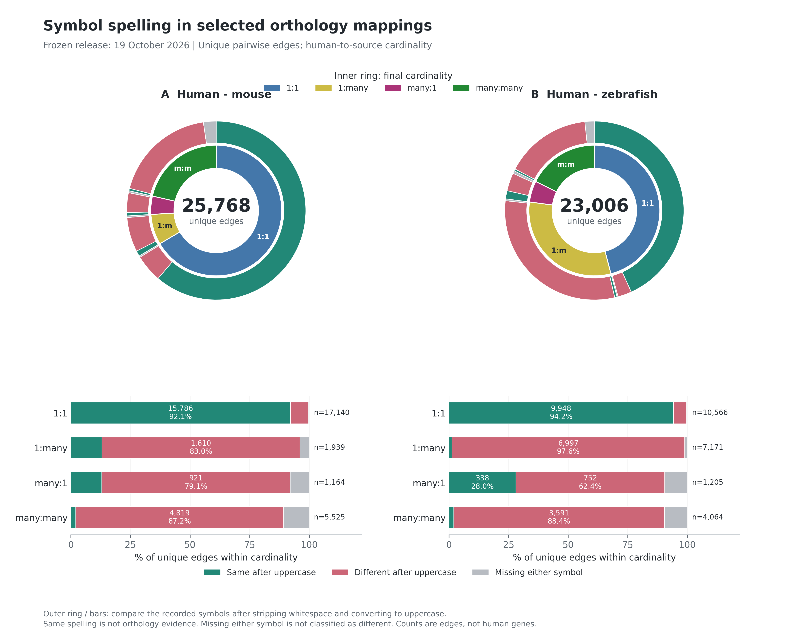

# heart-orthomap

Auditable, heart-focused mouse and zebrafish to human gene-feature conversion
for single-cell RNA counts. Developed by **Azad Alizada**, **Riley lab**, with
the **CellTalk HHD (Human Heart Development) consortium**.

This is a curated mapping resource and a count-conversion tool, not an
integration algorithm or a claim that every orthology assignment is validated.
The frozen 19 October 2026 release preserves the original human-mouse links
and prioritizes direct ZFIN human-zebrafish curation, with archived Ensembl
fallback. It includes the ZFIN-supported human `MYH6` to zebrafish `myh6`
assignment. It does **not** infer orthology by uppercasing a symbol.



## Mapping Overview

Complete selected canonical graphs, before feature-ID quarantine and before
restricting to genes measured in a particular dataset:

| Quantity | Human-mouse | Human-zebrafish |
| --- | ---: | ---: |
| Unique orthology edges | 25,768 | 23,006 |
| Human gene keys | 19,383 | 16,039 |
| Source gene keys | 20,487 | 19,012 |
| Human genes with several source orthologs | 1,079 | 4,268 |
| Source genes with several human targets | 1,408 | 1,275 |

These are graph counts, not expressed-gene totals or row counts in the triplet
table. The bundled mouse projection contains all 25,768 edges. The fish feature
projection contains 22,361 resolved edges and quarantines 645 rows for identifier
review, including malformed and colliding IDs. `MYH6-myh6` is retained. See the
[figure guide](docs/mapping_figures.md) and [methods](docs/METHODS.md) for exact
denominators, cardinalities and evidence.

## Install

Python 3.10 or newer:

```bash
pip install git+https://github.com/alizadaa/heart-orthomap.git
```

From a checkout, use `pip install .`. No network query, BioMart server or
cluster connection is needed when using the bundled frozen mappings.

## Choose a Count Policy

| Strategy | Multiple mouse/fish genes linked to one human gene |
| --- | --- |
| `one2one` (default) | Keep final reciprocal One2One pairs only |
| `sum` | Sum their raw integer counts, once per source feature |
| `best_sequence` | Keep the present source gene with the highest exact-pair sequence score |
| `best_expression` | Keep the present source gene with the highest supplied matched-group expression correlation |
| `highest_total_expression` | Legacy-style sensitivity: keep the gene with the largest raw-count total across the supplied input cells, not expression similarity |

Only `sum` aggregates distinct source genes. Both representative methods keep
one source feature per human target; sequence selection is not expression
selection. They do not average counts or p-values.

The orthology type columns are **human-perspective**. Human `One2Many` means
one human gene has several mouse/fish orthologs, so converting those genes
back to human can require summation or representative selection. Conversely,
a single source gene linked to several human genes would duplicate counts if
expanded. This implementation rejects it, or drops it only when explicitly
requested with `source_ambiguity="drop"`. No strategy duplicates source counts.

After feature-ID quarantine and removal of source genes linked to several
humans, **512 human targets in the mouse map and 3,073 in the zebrafish map**
still have several eligible source genes. These are the potential Sum cases
in the bundled conversion maps, not the larger complete-graph totals above.
Your dataset may contain only one or none of those candidate source genes;
the conversion report gives the actual number of aggregated output features.

## Python

```python
import anndata as ad
from heart_orthomap import load_bundled_mapping, convert_anndata

native = ad.read_h5ad("mouse_native.h5ad")
mapping = load_bundled_mapping("mouse")  # or "zebrafish"
result = convert_anndata(
    native,
    mapping,
    strategy="sum",
    counts_layer="counts",             # use None explicitly for raw .X
    source_ambiguity="drop",            # record ambiguous source genes as excluded
)
result.adata.write_h5ad("mouse_in_human_features.h5ad")
result.decisions.to_csv("mapping_decisions.tsv", sep="\t", index=False)
```

Use stable Ensembl IDs by default. If those are in `.var["ensembl_id"]`, pass
`feature_key="ensembl_id"`. Exact, case-sensitive symbols are also supported
with `feature_type="symbol"`; ambiguous symbols are not guessed. Human stable
IDs remain the default output feature names, with symbols in `.var`.

Duplicate input features, fractional/negative/nonfinite counts, score ties,
missing comparison scores and ambiguous mappings fail explicitly. Inspect
the decisions table or choose the documented drop policies. No input object
is modified. No normalization is performed.

## Your Final TSVs

```python
from heart_orthomap import load_mapping

mapping = load_mapping("human_mouse_final_mapping.tsv", source_species="mouse")
# Also supported, but pairwise coverage may be narrower:
projected = load_mapping(
    "human_mouse_zebrafish_final_mapping_annotated.tsv",
    source_species="mouse",
)
```

Both `human_mouse_zebrafish_selected_mapping.tsv` and the annotated version
are accepted. The correct **pairwise selected flag** is used and repeated
triad rows are deduplicated by stable-ID pair. For complete pairwise coverage,
prefer `human_mouse_final_mapping.tsv` and `human_fish_final_mapping.tsv`:
a three-species table need not contain every valid two-species link.

## Command Line

```bash
heart-orthomap audit --species mouse --out mapping-audit
heart-orthomap convert --species zebrafish --input native.h5ad \
  --strategy sum --counts-layer counts --source-ambiguity drop --out converted
```

Each new output directory contains the mapped H5AD, decisions table and JSON
accounting report. Existing output directories are never overwritten.

## Methods, Figures and Validation

- [Methods and limitations](docs/METHODS.md)
- [Mapping figures and their denominators](docs/mapping_figures.md)
- [Data provenance and upstream terms](DATA_SOURCES.md)
- [Validation and release limits](docs/VALIDATION.md)
- [Reproducible example](examples/convert_toy.py)
- Run the test suite with `python -m unittest discover -s tests -v`.

See the validation report for the independently executed reviewer checks.
The current package does not assert superiority over other tools: validation
of count arithmetic is separate from biological correctness of every edge.

## Metadata and Normalization

Cell barcodes and `.obs` are preserved. Cell-aligned embeddings/graphs are
copied without re-fitting. Gene-axis objects (`raw`, `varm`, `varp`), stale
feature analyses in `uns`, and unrequested layers are not copied, and the
report lists them. Only explicitly declared raw count layers may be projected.
The output `.X` and `.layers["counts"]` contain mapped raw counts.

Keep the native object for provenance and native-gene analyses. Mapping loses
or excludes some source genes, and representative selection intentionally
discards alternatives. Do not normalize using only a mapped/HVG-restricted
denominator when comparing strategies: use the original full-native library
size. The tool records the count sum over the supplied input features and
preserves existing native QC columns, but cannot recover genes removed before
the input object was supplied.

## License and Attribution

Code: MIT. Mapping data retain upstream Ensembl/ZFIN/supporting-source terms;
the code license does not relicense third-party data. Cite the original
orthology resources as well as this version of heart-orthomap. See
[DATA_SOURCES.md](DATA_SOURCES.md).
