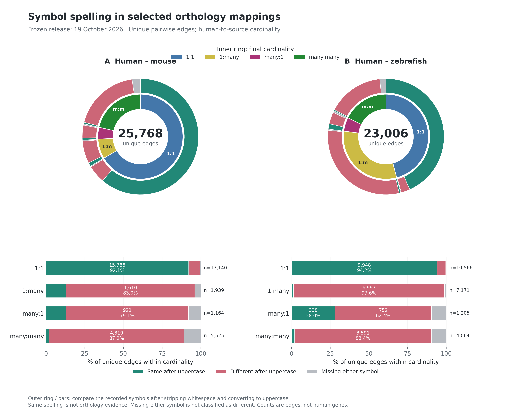
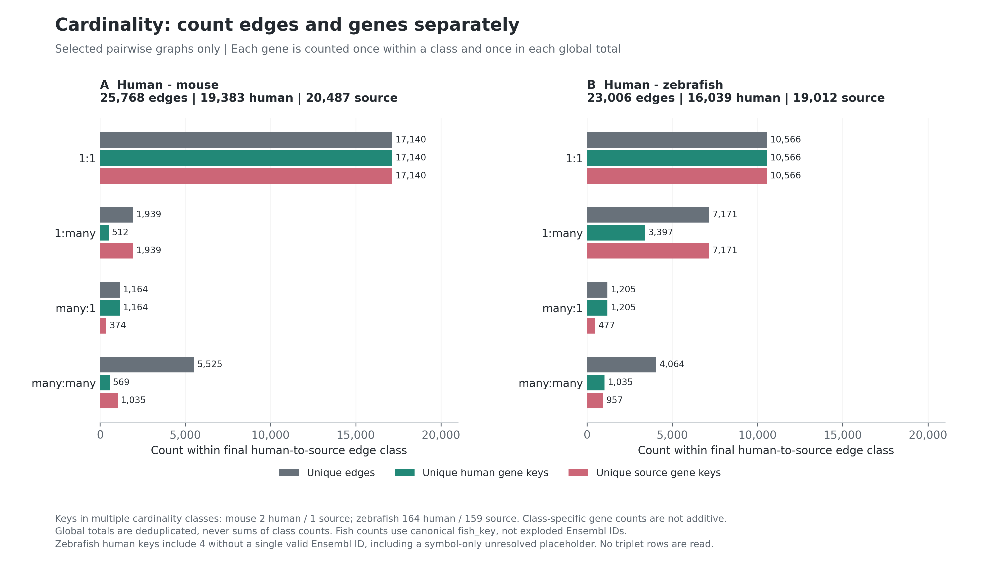
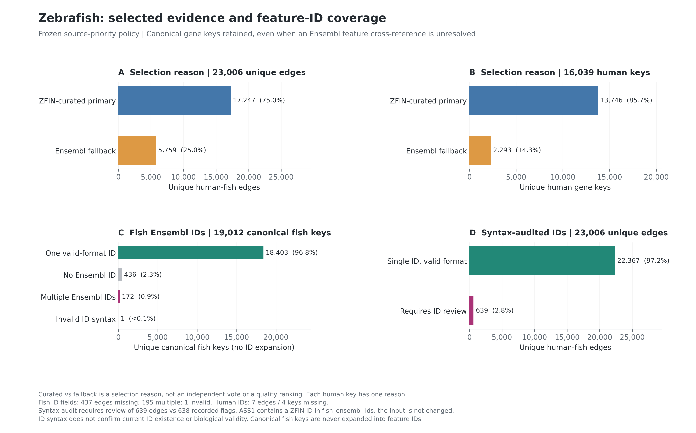
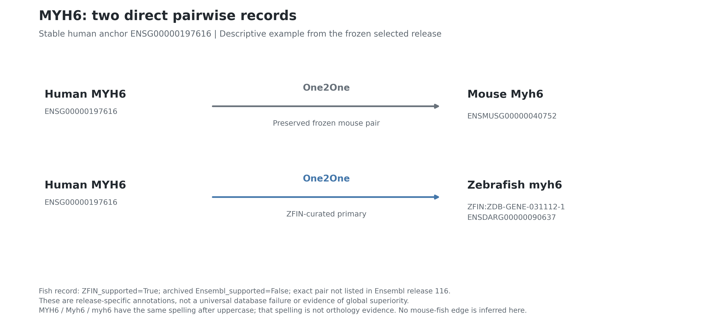

# Frozen Mapping Figures

Credit: **Riley lab / Azad Alizada / CellTalk HHD**.

These are descriptive audits of the selected orthology graphs frozen on **19 October 2026**, not benchmarks of global database superiority. They contain gene-level mapping information only: no patient, sample, or cell metadata. The plotting work does not modify or redistribute the third-party input tables and does not upload anything to GitHub. Public release remains subject to the package owner's independent validation and upstream data terms.

## Reproduce

From the `heart-orthomap` package root, with Python >=3.10, NumPy and Matplotlib installed:

```sh
python3 scripts/plot_mapping_audit.py --self-test
python3 scripts/plot_mapping_audit.py
```

The script writes four **300-dpi PNG + vector PDF** pairs and accompanying CSV/JSON counts to `docs/figures`. It uses Matplotlib's headless Agg backend, embedded TrueType PDF fonts, fixed colors and dimensions, sorted canonical edge keys, and PDF metadata without wall-clock dates. The JSON records Python, NumPy, and Matplotlib versions, the plotting-script SHA-256, input SHA-256 values, counting definitions, validation results, and every count table. Image bytes can depend on the recorded rendering-library versions.

For a separately located copy of the same frozen release:

```sh
python3 scripts/plot_mapping_audit.py --release-dir /path/to/release --output-dir docs/figures
```

The MYH6 panel and these captions describe this snapshot; recheck both before using a different release. The only input files read by the script are the two pairwise TSVs below. It never reads a human-mouse-fish triplet table.

## Input Provenance

Both inputs are under this path relative to the package root:

```text
../outputs/orthology_human_mouse_zebrafish_ZFIN_2026_10_19/final_mapping_2026_10_19/release/
```

| Frozen input | Bytes | SHA-256 |
| --- | ---: | --- |
| `human_mouse_final_mapping.tsv` | 17,185,202 | `c556547e95cd3fb3f1b2711954430236d61ca314d747dfabe805262c31bd3280` |
| `human_fish_final_mapping.tsv` | 31,236,487 | `6411284cc7b92932eb2e4b61f793fef4eb57382b22037abc1bc3653d6e801c08` |

The release's `mapping_policy.json` was inspected for context but is not a plotting dependency. It specifies preserved frozen human-mouse stable-ID pairs; ZFIN human-fish links when a human gene has any, otherwise archived Ensembl fallback; secondary sources as corroborating annotations; and Ensembl 116 scores as exact-pair annotations that do not replace the selected graph. Figure 3 uses the pairwise `final_mapping_reason`, not an inferred hierarchy based on score availability.

## Denominators And Labels

- A mouse **edge** is a unique `(human_ensembl_id, mouse_ensembl_id)` pair.
- A fish **edge** is a unique `(left_key, fish_key)` pair. All canonical keys are retained, including genes with unresolved Ensembl cross-references. A semicolon-delimited feature-ID field is inspected for coverage, never exploded into edges or gene counts.
- Human and source **gene counts** are unique endpoint keys in each pairwise graph, not numbers of edge rows. The human universes differ between species pairs; these totals are not a common expressed-gene universe, an atlas coverage percentage, or a three-species intersection.
- All 19,383 mouse-graph human keys are Ensembl IDs. The 16,039 fish-graph human keys comprise 16,035 with a single Ensembl ID, three unresolved HGNC keys, and one symbol-only placeholder (`human:SYMBOL:LOC105374780`). That last key is not a resolved stable gene ID; totals are therefore explicitly labelled **gene keys**.
- Cardinality is **human-to-source**. With unique-graph degrees `(human degree, source degree)`: `One2One` = `(1,1)`; `One2Many` = `(>1,1)`; `Many2One` = `(1,>1)`; `Many2Many` = `(>1,>1)`. The plot uses `1:1`, `1:many`, `many:1`, and `many:many`; compact donut labels use `m` for `many`. These are graph classes, not newly inferred evolutionary histories.
- An edge has exactly one cardinality; a gene can participate in multiple classes. Mouse has 2 human and 1 source keys spanning classes; fish has 164 human and 159 source keys spanning classes. Within-class gene counts are not additive. Global totals are deduplicated independently.
- **Same after uppercase** compares only the recorded primary symbols using `.strip().upper()`. It does not compare aliases or strip paralog suffixes. Missing either symbol is a separate third category; two empty values are not a match. Same spelling is **not orthology evidence**, and different spelling does not negate orthology.
- `All` rows in the exported CSVs are summaries, not additional observations to add to class rows. Fractions are unrounded in CSV/JSON; displayed percentages are rounded.

## Figure 1: Symbol Spelling



[Vector PDF](figures/01_symbol_spelling_nested_donuts.pdf).

**Caption.** Inner rings partition all selected unique edges by final human-to-source cardinality. Outer rings partition each corresponding cardinality wedge into same-uppercase spelling, different-uppercase spelling, or missing either symbol. The bars below show the same partitions normalized within each cardinality class; `n` is the number of unique edges in that class, and in-bar counts label sufficiently large segments. Ring areas and bars count **edges, not human genes**. No biological support is inferred from spelling.

| Pairwise graph | Same spelling edges | Different spelling edges | Missing-symbol edges | Denominator: unique edges |
| --- | ---: | ---: | ---: | ---: |
| Human-mouse | 16,302 (63.3%) | 8,634 (33.5%) | 832 (3.2%) | 25,768 |
| Human-zebrafish | 10,463 (45.5%) | 11,913 (51.8%) | 630 (2.7%) | 23,006 |

Exact within-cardinality counts are in [symbol_edge_counts.csv](figures/symbol_edge_counts.csv). The distinct human-key denominator is also exported in [symbol_human_key_counts.csv](figures/symbol_human_key_counts.csv): each human key is classified by all incident edges as all-same, all-different, mixed same/different, or missing a symbol on at least one edge (missing takes precedence). Those gene-level percentages must not be substituted for the edge-level donut percentages.

## Figure 2: Cardinality Without Row Inflation



[Vector PDF](figures/02_cardinality_edges_and_genes.pdf).

**Caption.** Counts of unique edges, unique human gene keys, and unique source gene keys within each final cardinality class. Global totals shown above each panel are deduplicated across the entire pairwise graph. Fish source counts use `fish_key`, not individual Ensembl cross-reference tokens. Class-specific gene totals can overlap and must not be summed.

| Graph | Class | Edges | Unique human keys | Unique source keys |
| --- | --- | ---: | ---: | ---: |
| Human-mouse | All | 25,768 | 19,383 | 20,487 |
| Human-mouse | One2One | 17,140 | 17,140 | 17,140 |
| Human-mouse | One2Many | 1,939 | 512 | 1,939 |
| Human-mouse | Many2One | 1,164 | 1,164 | 374 |
| Human-mouse | Many2Many | 5,525 | 569 | 1,035 |
| Human-zebrafish | All | 23,006 | 16,039 | 19,012 |
| Human-zebrafish | One2One | 10,566 | 10,566 | 10,566 |
| Human-zebrafish | One2Many | 7,171 | 3,397 | 7,171 |
| Human-zebrafish | Many2One | 1,205 | 1,205 | 477 |
| Human-zebrafish | Many2Many | 4,064 | 1,035 | 957 |

Sources: [graph_totals.csv](figures/graph_totals.csv), [cardinality_counts.csv](figures/cardinality_counts.csv).

## Figure 3: Fish Evidence And ID Coverage



[Vector PDF](figures/03_fish_evidence_and_id_coverage.pdf).

**Caption.** A: Selected human-fish edges partitioned by recorded selection reason: 17,247 ZFIN-curated primary edges and 5,759 Ensembl-fallback edges (23,006-edge denominator). B: The corresponding disjoint human-key partition is 13,746 curated and 2,293 fallback keys (16,039-human-key denominator). C: Ensembl cross-reference status across 19,012 unique canonical fish keys: 18,403 have one syntactically valid-format ID, 436 have none, 172 have multiple IDs, and 1 has invalid ID syntax. D: Syntax-audited feature coverage across 23,006 edges: 22,367 have one valid-format ID on each side; 639 need ID review. Syntax is checked against `ENSG`/`ENSDARG` followed by digits, not against a live Ensembl database. A valid format does not establish present-day identifier existence, mapping quality, functional equivalence, or a universally appropriate count-mapping policy.

**Concrete upstream bug, not silently repaired.** Human `ASS1` (`ENSG00000130707`) maps to canonical fish key `ZFIN:ZDB-GENE-040912-178` (`ass1`), but its `fish_ensembl_ids` field is `ZDB-GENE-040912-178`, a ZFIN ID. The frozen flags nevertheless say `usable_for_Ensembl_feature_mapping=True` and `requires_feature_ID_review=False`. Thus the recorded flag totals are **22,368 usable / 638 review**, while the explicit syntax audit yields **22,367 valid-format / 639 review**. Canonical-edge, gene-key, and symbol counts are unchanged. No correct replacement Ensembl ID is guessed. The owner should resolve or explicitly gate this record before public use as an Ensembl feature map.

At the edge level, fish Ensembl fields are missing on 437 edges, multiple on 195 edges, and invalid on 1 edge. Human Ensembl IDs are missing on 7 edges involving 4 human keys; one of those edges also lacks a fish ID. Therefore `437 + 195 + 1 + 7 - 1 = 639` edges need syntax-audited review. This is distinct from the 436 missing / 172 multi-ID / 1 invalid **unique fish-key** counts. Multiple cross-references do not create multiple fish genes.

The package's count-conversion projection additionally quarantines six edges
where three valid-format fish feature IDs refer to different canonical genes.
Consequently it bundles **22,361 active edges and 645 quarantined rows**.
Figure 3 describes syntax coverage of the unchanged canonical graph, not the
stricter set eligible for count conversion. The ASS1 record is excluded from
conversion rather than repaired with a guessed ID.

Curated/fallback categories describe the frozen selection policy, not mutually independent votes or an evidence-quality ranking. A fish key may occur under both selection reasons via different human keys; source-key counts by reason need not sum to the global fish-key total. Scores, algorithms, and secondary support are not treated as independent votes.

Sources: [fish_evidence_counts.csv](figures/fish_evidence_counts.csv) (also split by final cardinality), [fish_id_coverage.csv](figures/fish_id_coverage.csv), [fish_joint_id_coverage.csv](figures/fish_joint_id_coverage.csv), [fish_feature_mapping_counts.csv](figures/fish_feature_mapping_counts.csv), and [id_validation_issues.csv](figures/id_validation_issues.csv).

## Figure 4: MYH6 Mapping Story



[Vector PDF](figures/04_myh6_pairwise_story.pdf).

**Caption.** The human anchor is located by stable ID `ENSG00000197616`, not a symbol join. Its selected direct mouse edge is `Myh6`, `ENSMUSG00000040752`, classified `One2One`. Its selected direct fish edge is `myh6`, canonical key `ZFIN:ZDB-GENE-031112-1`, Ensembl cross-reference `ENSDARG00000090637`, also `One2One`, selected as `ZFIN_curated_primary`. The fish row records `ZFIN_supported=True`, archived `Ensembl_supported=False`, and `not_listed_for_exact_pair_in_Ensembl116`. These snapshot-specific annotations do not claim that every Ensembl release lacks this orthology, nor that one source is globally superior. All three displayed symbols agree after uppercase, but spelling is not the evidence selecting the edges. No direct mouse-fish edge, three-species reciprocal relationship, functional equivalence, or regulatory conservation is inferred.

Source: [myh6_edges.csv](figures/myh6_edges.csv).

## Validation And Remaining Caveats

The script checks required columns, nonempty canonical endpoints, selected flags, exact duplicate/conflicting pair records, and recomputed forward/reverse graph degrees and cardinalities. It checks fish evidence reasons against recorded ZFIN/archived Ensembl support, consistent cross-reference fields per canonical key, recorded feature flags against raw ID-token cardinality, and the two expected MYH6 direct edges. The frozen tables have **no duplicate pair rows** and **no degree/cardinality disagreements**. The known ASS1 syntax defect is exported, not hidden behind a passing flag check.

Self-tests cover graph-class direction, uppercase spelling, missing-symbol behavior, deduplicated ID tokens, multi-ID coverage, invalid Ensembl syntax (including the ZFIN-ID defect), and rejection of invalid booleans/degrees. All four output PNGs were visually inspected with `view_image`; layout, label legibility, rings/bars, and MYH6 IDs were checked. All four vector PDFs were also rendered with Poppler and visually inspected. Two complete final runs produced **19 byte-identical generated artifacts** (8 image/PDF files, 10 CSVs, and 1 JSON). Every CSV row was compared with its JSON counterpart; edge and human-key partitions, input/script hashes, and documentation artifact links were checked. The machine-readable audit is [mapping_audit_counts.json](figures/mapping_audit_counts.json).

These checks validate descriptive consistency, not biological correctness of all orthology links. They do not audit licensing, upstream database completeness, gene expression, cell-type performance, or all package count-mapping behavior. Final public-release approval and the independent count audit belong to the package owner.
